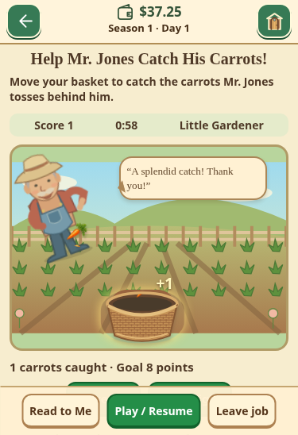
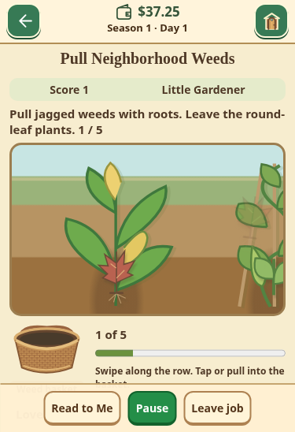
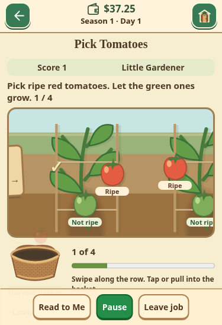

# Phase 9 playtest improvements

Only the permanent preview repository is changed. Existing illustrated farm,
market, shops, village and room assets remain unchanged. New original inline SVG
components in `neighborhood-art.js` and scoped scene styles add the neighborhood
artwork; no remote art or runtime dependency is required.

## Touch and presentation

- Both experience choices activate on a stationary touch release, without relying
  on Safari's synthesized click. The selected mode has a check, gold outline,
  pressed state and “Playing as…” status. Mouse/keyboard activation remains.
  Scrolling/canceled gestures do not activate choices; a delayed click cannot
  double-activate a replacement screen. The next deliberate tap is never blocked.
- Stack Sort supports select-top/tap-destination and top-only dragging. Highlight,
  visible order, Undo and Restart all use the same crate arrays. Invalid moves
  retain the selection and explain empty/matching crates.
- Match has popping vegetables, particles, floating points, dropping replacements
  and cascade sequences. New sessions award 10 points per cleared vegetable,
  15 extra per vegetable beyond four, and 20 per cascade depth. Successful
  matches within 15 active seconds form a streak (10 extra per step, capped at
  40). Optional existing sound effects remain controlled in Settings.
- Mr. Jones has a full illustrated body, straw hat, overalls, face and animated
  pulling/throwing arm. The garden has perspective rows, fencing and flowers.
  Carrots follow one shared physics path; catches occur at the visible basket
  opening. Caught carrots immediately leave the flying layer, with a clipped
  opening effect; misses bounce and fade. Large carrots and delighted reactions
  remain occasional. Targets and the 60-second active clock are unchanged.
- Weeds and tomatoes are horizontal garden rows with intact healthy plants,
  labeled ripe/unripe fruit, illustrated stalks, roots, soil particles, baskets,
  start/end markers and progress. Picking advances toward remaining work.
  Swiping the background explores the row; tap or drag works on the plants.
- Flowers occupy deterministic positions within 36 mixed flower/path/grass/soil
  plots. New sessions have 9 thirsty flowers in Little and 12 in Growing.
  Only flower beds need watering. A sticky can supports drag or pick-can/tap;
  watered flowers bloom over darker soil with visible droplets/check marks.
  Flower targets are at least 44 pixels wide at a 320-pixel viewport.
- Packing has three independent ordered lanes with near-end pickup markings,
  wicker bushels and visible next items. Only each lane's front item is available.
  Each replacement travels from the far end; other lanes do not jump. Little
  takes 6.5 active seconds to reach pickup; Growing takes 4. Items wait at pickup
  rather than penalizing slower children. Tap-select/basket is an alternative to
  dragging. Dragged produce holds position during its gesture.
- Pause/Read/Leave and optional audio remain available. Reduced motion disables
  decorative animations; active carrots still move so the catch game is playable.
  Small phones can scroll vertically where 44-pixel targets require extra space.

## Save compatibility and unchanged systems

Save keys `mgg10`/`mgg10-backup` and farm version 1 are unchanged. Each newly
started optional job carries `rulesVersion: 2`. Existing sessions without it
replay under version 1, retaining their exact puzzle, score, flower target and
catch timing. New scoring/queue rules cannot invalidate old replay logs.
Twenty synthetic pre-update saves (ten jobs × two modes) cover this migration.
No real player data was accessed or reset.

Mode switching preserves the current job's puzzle and earned work. Its original
experience remains on that job's status bar; newly started jobs use the selected
experience. The Settings explanation makes this explicit. Existing Garden nature
lesson adaptation is unchanged. Word Search, Mrs. Magee's labels, the separate
five-day Garden bonus, market sessions, money, inventory, dream ownership and
placements are unchanged. Every job still pays exactly $1 once and has its own
five-minute cooldown. Cooldown expiry stays silent.

## Validation

- `npm test`: 247 passing rule/regression tests, including old-session replay,
  mixed 36-plot gardens, independent packing queues, catch opening/edge/big-carrot
  collision, scoring/cascades/streaks, correct/incorrect row selections and payouts.
- `tests/mobile_neighborhood.py`: all ten jobs × both modes × three phone sizes,
  real touch taps/drags, one-dollar reward, independent cooldown and reload.
- `tests/mobile_job_playtest.py`: mode/save invariants; touch releases without
  compatibility clicks; top-only stack taps/drag/invalid moves/Undo/Restart;
  moving queues; rows; flower hit areas/blooming; caught-layer removal; match
  effects; reduced motion. 320×440, 375×548 and 428×746.
- Phase 9 integration and result-touch suites cover starter supplies, earnings,
  equipment, both market paths, narration/letter audio, and duplicate delivery.
- Existing mobile guidebook, Garden weeding and cents-market suites check
  unchanged gameplay, saved progress, clock pause and money handling.

Browser automation uses Chromium touch at iPhone-sized available viewports,
including simulated safe areas in the existing suites. Actual Safari hardware,
VoiceOver and the subjective feel of the new artwork still need family playtesting.
No native Safari result is claimed.

## Review images

Screenshots use an isolated synthetic farm, not a child's saved game.

